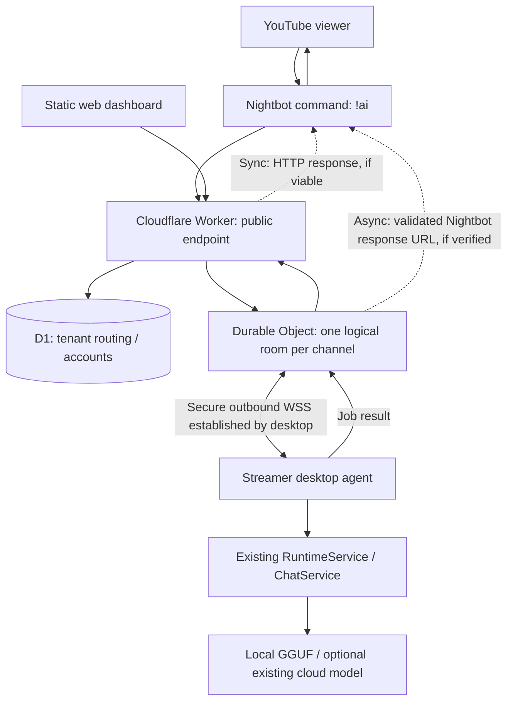

# YouTube AI Chatbot -> Local-First Streaming SaaS
## Master Engineering Blueprint and Living Development Plan

**Version:** 1.1  
**Prepared:** 2026-11-02  
**Status:** IN PROGRESS - environment and original test baseline verified; Cloudflare implementation not started  
**Repository:** https://github.com/DAXXY-777/Youtube-AI-Chatbot  
**Source branch reviewed:** `master` (public GitHub pages reviewed 2026-11-02; exact commit SHA not captured)  
**Recommended home for this document:** `docs/saas-blueprint.md` in the project repository  
**Companion handoff file:** `docs/saas-session-handoff.md`

> **How to use:** This is the source of truth for scope, architectural decisions, tasks, acceptance criteria, and resuming work. Update task boxes only when evidence shows the task passed. Save both Markdown files to the repository and commit them before leaving a temporary chat. The PDF is a reading copy; edit the Markdown.

---

## 0. Executive summary

### One-sentence product
A cloud-managed, local-first AI streaming assistant that gives each streamer a stable Nightbot-compatible public URL without exposing their PC, while local AI inference and chat memory remain on their computer.

### Design principles
1. **Local-first inference.** Keep `llama-cpp-python`, existing Cloud responder, YouTube ambient memory, and existing desktop settings working. Cloudflare is not the model host.
2. **No port forwarding.** The desktop app establishes an **outbound** authenticated WebSocket to Cloudflare. Neither the Gradio UI nor the local FastAPI port is exposed directly.
3. **Multi-tenant from the start.** Each public command resolves to exactly one streamer/channel and cannot reach another tenant's device.
4. **Free-tier-conscious, not free-tier-guaranteed.** Keep the MVP within published Cloudflare Free limits where practical; monitor quotas and plan for failures or paid migration.
5. **Secure-by-default.** Revocable credentials, bounded requests, channel-bound routing, no secrets in URLs/logs, no arbitrary file or command execution.
6. **Preserve current behavior.** Existing `uv run python main.py`, `uv run python desktop.py`, local endpoints, tests, and standalone mode should continue to work.
7. **Evidence-driven implementation.** Every milestone has an exit test. No 'done' without passing evidence.

### What "50% today" means
**Target: 6 of 12 checked, verified items in the Foundation Sprint (F01-F12).** This is a measurable 50% of the immediate integration sprint, **not** 50% of the complete commercial SaaS. A full SaaS also requires security, authentication, dashboards, testing, distribution, and operations. The sprint begins at **0/12 verified** in this document; planning alone does not complete an engineering task.

---

## 1. Verified current state versus open questions

### 1.1 Verified from the public repository (as reviewed 2026-11-02)

| Area | Verified current implementation | Evidence |
|---|---|---|
| Application | Windows-first Python desktop program built around Gradio, pywebview, FastAPI, SQLAlchemy/SQLite | Repository README |
| Local UI | Private Gradio UI on `127.0.0.1:7860` | README and `main.py` |
| Nightbot API | Local `GET /api/nightbot/ai` on `127.0.0.1:7861` | README and `api.py` |
| Generation | `chat_service.respond(request_context, viewer, prompt)` chooses local GGUF or cloud responder | `chat_service.py` |
| Existing safeguards | Viewer cooldown, prompt/response bounds, queue/timeouts; do not remove without tests | README and `api.py` |
| Storage | Local SQLite and OS keyring for sensitive provider credentials | README |
| YouTube context | `pytchat-ng` for transient ambient context | README |
| Run from source | `uv sync --group build`; `uv run python main.py`; Python >= 3.14 | README and `pyproject.toml` |
| Existing test invocation | `uv run python -m unittest discover -s tests -v` | README |

**Important separation:** The uploaded standalone `app.py` in this conversation is a **proof of concept outside the reviewed GitHub project**. It has `relay_loop()`, `lifespan()`, and `/health`, opens an outbound WebSocket, and returns a hard-coded `REPLY`. We have **not** established that it is checked into the repository or integrated with `chat_service.respond()`.

### 1.2 Not yet verified

- Current local machine OS, editor, installed Python/uv/Node/Wrangler versions.
- Current local clone branch, uncommitted changes, exact commit SHA, and current test results.
- Whether a Cloudflare account, Worker, Durable Object, D1 database, and Nightbot OAuth application already exist.
- Any separately written Cloudflare Worker source, its exact routes, and credentials.
- End-to-end behavior of Nightbot's delayed `Nightbot-Response-Url` for a slow local model, including empty immediate HTTP replies and callback validity.
- Performance, user concurrency, and actual Cloudflare usage at expected traffic levels.

**Status convention:** VERIFIED = inspected document/code or a passing test; PROPOSED = architecture to implement; EXPERIMENT = a hypothesis that requires a spike/test.

---

## 2. Scope: MVP, beta, and later product

### 2.1 Primary user story

> As a YouTube streamer, I can install the desktop app, pair it with a website, install a Nightbot `!ai` command, and receive AI responses in my chat without exposing a local port or managing a Cloudflare tunnel.

### 2.2 Minimum viable SaaS (required for early closed alpha)

- Stable public Nightbot URL per channel/streamer.
- Outbound desktop WebSocket that survives disconnects and re-registers after reconnect.
- Routing isolated per account/channel/device.
- Real `ChatService` responses rather than hard-coded text.
- At least one verified reply delivery path to Nightbot (synchronous or delayed, selected by evidence).
- Clearly defined offline/error/timeout behavior.
- Authentication for the desktop connection; capability/secret for public command route; rotation and throttling.
- Minimal user onboarding (manual setup acceptable during internal alpha).
- Deployment, monitoring, abuse controls, rollback procedure, and local regression tests.

### 2.3 Public beta requirements

- Nightbot OAuth with the least scopes necessary, account sessions, secure device pairing, and revocation.
- D1-backed account/channel/device mapping, usage summaries, and quota enforcement.
- Dashboard with online state, commands, usage, basic AI settings and onboarding instructions.
- Privacy controls, support docs, release builds, basic accessibility and mobile-responsive dashboard.

### 2.4 Deferred until after public beta

Payments/subscriptions, marketplace, third-party integrations beyond Nightbot/YouTube, OBS actions, arbitrary scripting/plugin execution, AI model hosting, team organizations, sophisticated analytics, mobile app, and cross-platform desktop packaging beyond the currently verified Windows-first environment. Do not imply these are included in MVP.

---

## 3. Proposed system architecture



### 3.1 Responsibility boundaries

| Component | Owns | Explicitly does not own |
|---|---|---|
| Worker | Public HTTP routing, input validation, API auth, Nightbot response handling, rate limits, D1 lookup | Model inference; access to local UI |
| Durable Object (DO) | Per-channel active WebSocket(s), bounded job routing, connection status, pending correlation, hibernation | Persistent full chat history; arbitrary remote desktop actions |
| D1 | Accounts, channel mapping, device records, route key hashes, settings metadata, aggregated usage | Model weights; raw prompts/transcripts by default; cloud provider API keys from desktop |
| Desktop agent | Outbound WSS, generate locally, reconnect, local credentials, existing app services | Inbound Internet socket or privileged remote command execution |
| Local UI + local API | Existing desktop experience, optional direct Nightbot legacy mode | Publicly hosted settings UI |
| Dashboard | Self-service account/device status, setup, configuration, usage | Private inference data, direct desktop control without authenticated narrow APIs |

### 3.2 Why Durable Objects rather than a regular always-on Worker WebSocket?

Cloudflare's Durable Object **WebSocket Hibernation API** allows the connection to stay established while the object sleeps. Use `ctx.acceptWebSocket()` and restore necessary connection metadata after hibernation (do not rely only on instance fields). Protocol ping/pong is handled without waking the object. On the Free plan, use a **SQLite-backed** Durable Object. Confirm actual metered usage after deployment.

### 3.3 Tenant key design (PROPOSED)

Use a stable server-created `channel_id` as the logical Durable Object name/input. Public URLs should contain a separate long, randomly generated **revocable route capability** (not predictable username alone); look up only that specific channel in D1. Route capabilities authorize only bounded Nightbot job creation, never device connection or account administration. Hash route capabilities at rest, enforce quotas and rotation, and do not treat `Nightbot-User` or `Nightbot-Channel` as cryptographic authentication. Bind claimed channel identity against account configuration when available.

### 3.4 Desktop model

- One desktop agent with a revocable device credential.
- WebSocket bearer token sent in the connection header (existing Python client supports custom headers).
- Cloudflare authenticates **before** accepting/forwarding WebSocket traffic.
- On disconnect mark offline; backoff with jitter; reject stale/replayed responses and queued work after deadlines.
- If there are multiple devices, define one active primary device per channel for MVP; device selection/HA is a later feature.

---

## 4. Request and account flows

### 4.1 First-time onboarding (beta target)

1. Streamer signs in through Nightbot OAuth on the SaaS website.
2. Backend obtains the authorized Nightbot user/channel identity (validate OAuth state and exact callback), creates their SaaS account/channel records, and stores required tokens securely only if needed.
3. Website displays a short-lived device pairing code.
4. Desktop app submits the code using an authenticated pairing flow. Backend issues a revocable device credential bound to one account/channel.
5. Desktop connects **outbound** to the appropriate DO over WSS.
6. Website displays connection state and generates/install the channel's Nightbot command. Permission to modify commands must be separately requested (`commands` scope); provide manual copy/paste fallback.
7. Streamer runs an internal test before using the command live.

**Internal alpha shortcut:** Manual pairing/route config is acceptable, but must not become the long-term security design.

### 4.2 Viewer request

1. Viewer invokes `!ai` in YouTube chat; Nightbot URLFetch calls the stable HTTPS Worker endpoint.
2. Worker validates route capability, bounded query length, channel config, quotas, and request identifiers; never trusts header identity for authentication.
3. Worker identifies exactly one DO and relays a versioned job with an opaque job ID and absolute deadline.
4. DO sends job only to the authenticated active desktop for that channel; enforce bounded queue and concurrency.
5. Desktop invokes existing application service and returns `reply` (or a typed error) with matching job ID.
6. Cloudflare routes the response back via a **verified** Nightbot delivery strategy. Do not send duplicate messages.
7. Counters/diagnostics are updated without storing raw prompts by default.

### 4.3 Critical experimental decision: Nightbot reply delivery

- **Synchronous option:** Keep the HTTP request open for an end-to-end response, with a strict timeout and offline fallback. Simpler, but may time out on slower local models.
- **Delayed option:** Capture the `Nightbot-Response-Url` header and POST the eventual result to the provided response URL; quickly complete the original URLFetch request. This header is documented, **but** the exact HTTP status/body behavior, callback validity, duplicate-message behavior, and time limits must be verified against a real Nightbot test channel before adoption.
- Never send callback traffic to an arbitrary URL: enforce trusted Nightbot HTTPS host/path expectations, disable open redirects, cap response size, and avoid logging callback tokens/URLs. Treat the URL as a short-lived bearer secret.
- **Decision gate:** Phase 2 experiment NB-01 selects sync or delayed. Do not prematurely hard-code async as guaranteed.

### 4.4 Offline/failure states

| Condition | Required behavior |
|---|---|
| Device offline | Friendly short reply or explicit no-response (tested against Nightbot), never indefinite wait |
| Local generation deadline | Cancel/expire job; late `reply` ignored; no second chat message |
| Network loss mid-generation | Reconnect safely; avoid replaying accepted work without idempotency key |
| Duplicate job ID | At most one delivery; duplicate does not repeat inference/chat post |
| Invalid public route | Return indistinguishable short error/404; rate limit |
| Revoked desktop token | Reject connection/reconnection immediately |
| Cloudflare quota exhaustion | Document degradation, alert operator, no promises of uninterrupted service |

---

## 5. Proposed protocol and interface contract (NOT YET IMPLEMENTED)

Define the JSON message envelope before implementing new code. Keep it versioned so the desktop and Worker can evolve independently.

```json
{
  "v": 1,
  "type": "ask",
  "id": "opaque-job-id",
  "channel_id": "server-controlled-channel-id",
  "viewer": {"id": "external-viewer-id", "name": "display name"},
  "prompt": "viewer question",
  "deadline_ms": 0
}
```

```json
{
  "v": 1,
  "type": "reply",
  "id": "opaque-job-id",
  "text": "bounded, sanitized answer"
}
```

```json
{
  "v": 1,
  "type": "job_error",
  "id": "opaque-job-id",
  "code": "busy|timeout|unavailable|invalid_request"
}
```

**Protocol invariants:** `id` is unique within a reasonable window; server derives channel from authenticated context rather than trusting client-supplied `channel_id`; all fields have size limits; no raw stack traces; no arbitrary client-selected callback URLs; model content sanitized to Nightbot output limits. `deadline_ms` is only illustrative; select and document exact units and validation before implementation.

### Proposed external routes (paths are design proposals, not existing source files)

| Route | Purpose | Auth |
|---|---|---|
| `GET /health` | Liveness of the cloud Worker (not inference availability) | Public, minimal output |
| `GET /n/{route_capability}` | Nightbot URLFetch command target | Long random route capability + quotas |
| `GET /ws` | Desktop WebSocket upgrade | Device bearer credential, channel binding |
| `GET /api/v1/me` | Dashboard account summary | Session |
| `POST /api/v1/device-pairings` | Create one-time pairing code | Session + anti-CSRF |
| `POST /api/v1/device-pairings/redeem` | Exchange pairing code for device credential | Single-use, short expiry, rate limited |
| `POST /api/v1/devices/{id}/revoke` | Revoke device | Session + owner check |
| `GET /api/v1/usage` | Daily aggregates only | Session + owner check |

Keep the public Nightbot URL stable even if later internal API routes change. The existing local `GET /api/nightbot/ai` stays intact for compatibility.

---

## 6. Data model and security boundaries

### 6.1 Conceptual D1 tables (PROPOSED)

- **users:** `id`, `nightbot_user_id`, `created_at`, `status`.
- **channels:** `id`, `owner_user_id`, `nightbot_channel_id`, `display_name`, `active_device_id`, `created_at`.
- **devices:** `id`, `channel_id`, `name`, `credential_hash`, `revoked_at`, `last_seen_at` (avoid writes on every ping).
- **command_routes:** `id`, `channel_id`, `capability_hash`, `rotated_at`, `disabled_at`.
- **usage_daily:** `channel_id`, `date_utc`, `accepted_count`, `error_count`, `delivery_count`.
- **oauth_tokens (only if needed):** encrypted refresh/access token material, expiry, scope and rotation metadata; NEVER plaintext secrets in dashboard responses.

Use indexes on channel/user lookup and unique constraints on Nightbot identity. Keep any pending Nightbot callback URLs in short-lived, private storage with explicit TTL, never analytics or logs. Specify deletion, credential rotation, and account unlinking behavior before public beta.

### 6.2 Threat model (minimum)

| Threat | Mitigation / test |
|---|---|
| Someone forges Nightbot headers/URL query | Treat these as untrusted; bind requests to a per-channel route capability; rate limit |
| Leaked route URL | Rotation, account-level disable, quotas, detection; route never grants desktop/admin access |
| Stolen desktop device token | Store safely locally; hashes server-side; revoke, rotate, reduce scope |
| Malicious `Nightbot-Response-Url` | Allowlisted Nightbot destination; HTTPS; no arbitrary redirects; prevent SSRF |
| Cross-tenant request routing | Derive tenant from auth, enforce tenant-specific DO, integration tests with two channels |
| Huge prompts / response abuse | Input cap, output cap, cooldown, queue limit, deadline, request size check |
| LLM prompt injection | Treat viewer text/ambient chat as untrusted content; do not expose tools, filesystem, shell, or secrets to generated actions |
| Logging sensitive chat | Structured counts and error codes; redact prompts, response URLs, bearer tokens, OAuth secrets |
| Cloudflare Free exhausted | Visibility, operator alerts, graceful failure; no dependency on paid products in MVP |
| OAuth account takeover / CSRF | `state` validation, exact callback, secure cookies, least scope, secret handling |

**Privacy caveat:** Inference stays local but viewer prompts and replies necessarily **transit Cloudflare** (and Nightbot). This is not end-to-end encryption from Nightbot to the PC; don't market it that way.

---

## 7. Cloudflare Free budget and instrumentation

**Published documentation checked 2026-11-02. These are limits, not guaranteed capacity. Recheck before deployment.**

| Component | Free limits relevant to MVP | Implication |
|---|---|---|
| Workers | 100,000 requests/day; 10 ms CPU per invocation | Keep Worker compute small and avoid polling |
| Durable Objects | 100,000 metered requests/day; 13,000 GB-s/day of duration | Use SQLite-backed DO + WebSocket Hibernation; no continuously active idle objects |
| D1 | 5M rows read/day; 100k rows written/day; 5 GB account storage, **500 MB per free database** | No transcript table; index lookups; summarize usage |
| Workers Static Assets | Static asset requests free and unlimited (within other platform constraints) | Serve dashboard assets statically; API calls still count |
| Nightbot | URLFetch plain-text response <400 characters; `Nightbot-Response-Url` available | Preserve current app 280-char response policy until reviewed |

**Beware accounting:** Free Workers requests reset at midnight UTC and fail when the limit is reached. DO metering also includes request messages; per DO pricing docs, 20 incoming application WebSocket messages are charged as one metered request for compute request billing; protocol ping messages do not count. The Worker/DO/D1 metrics are different dimensions, so don't simply add them into one number. D1 free per-database maximum is not the same as the total account storage quota.

### Example budgeting (planning heuristic; measure actual deployment)

If each Nightbot question results in an estimated **2-4 Worker invocations**, 100,000 Worker requests/day alone suggests an upper estimate of roughly 25,000-50,000 questions/day **before** accounting for sign-ins, reconnects, dashboards, retries, malformed requests, and other traffic. This is a planning estimate, NOT a capacity guarantee. DO/D1 could become the binding limit earlier.

**Track daily:** Worker requests/CPU/failed requests; DO requests, GB-s and WebSocket connection count; D1 read/write rows; per-channel accepted jobs, timeout percentage, average inference turnaround (aggregated), Nightbot delivery failures. Establish budget warning thresholds (for example 50%, 75%, 90%) and manual operational response. Avoid high-frequency heartbeat HTTP requests and database writes on each protocol ping.

**Do not rely on:** Workers AI, GPU inference in Cloudflare, paid Queues or R2, commercial email/SMS, or paid user-auth services for the free-tier MVP.

---

## 8. Detailed roadmap with acceptance gates

**Progress rule:** Each task is marked `[ ]` until tests pass; completed tasks also record a Git commit/PR or clear terminal evidence. Phases may be done across sessions. Don't skip prerequisite verification. No implementation has been verified during preparation of this blueprint.

### PHASE 0 - Repository health and a safe development branch

**Purpose:** Preserve the existing desktop app, understand dependencies, and have a reproducible known-good starting point.

- [x] P0-01 Record local OS, `git`, Python, `uv`, Node and installed tools. (2026-11-02)
- [ ] P0-02 Inspect branch/working tree; save changes safely; create `feat/cloudflare-saas-relay` only after checking local state.
- [ ] P0-03 Install dependencies using existing uv project instructions; run existing unit tests; capture result.
- [ ] P0-04 Smoke-test existing UI + local API without a tunnel; confirm ports and normal response path.
- [ ] P0-05 Commit blueprint and handoff docs; note baseline commit SHA.

**Exit gate:** clean/safely backed-up branch, baseline test results known (pass or failures documented), existing app still launches. **Do not rewrite the desktop app in this phase.**

### PHASE 1 - Cloudflare relay foundation

**Purpose:** Replace the need for user-managed tunnels with one provider-operated Cloudflare endpoint.

- [ ] P1-01 Create isolated `cloudflare/` Worker project with predictable local dev configuration, no production secrets in git.
- [ ] P1-02 Deploy/test an inexpensive Worker health endpoint.
- [ ] P1-03 Add SQLite-backed Durable Object using `ctx.acceptWebSocket()` and verified hibernation semantics.
- [ ] P1-04 Evolve the uploaded `app.py` proof of concept into a versioned, authenticated outbound client (initially constant `REPLY` for the test).
- [ ] P1-05 Prove one complete Cloudflare -> PC -> Cloudflare job/reply round-trip.
- [ ] P1-06 Verify reconnect/offline handling and appropriate API status; inspect actual usage metrics.

**Exit gate:** a request sent to the public Worker is delivered to an authorized PC and returns a correlated response without an inbound PC port. Reconnect test passes. Hibernation verified in hosted environment, not inferred only from local dev.

### PHASE 2 - Real inference and Nightbot end-to-end

**Purpose:** Connect the relay to `chat_service.respond()` without breaking its cooldowns or local operation.

- [ ] P2-01 Map service initialization and existing `api.py` behavior; select safe integration entry point (inspect `main.py` lifespan before adding tasks).
- [ ] P2-02 Make relay invoke the existing chat service off the asyncio event loop; preserve queue, deadline and per-viewer cooldown.
- [ ] P2-03 Add typed job errors, idempotency, prompt/answer bounds and cancellation/late reply logic.
- [ ] P2-04 Run **NB-01** Nightbot timing test with a real test channel and a deliberately slow response. Compare synchronous and delayed-response URL methods.
- [ ] P2-05 Implement only the tested Nightbot reply strategy; ensure no duplicate/blank/ghost chat messages.
- [ ] P2-06 Test `!ai` prompt, blank prompt, cooldown, offline desktop and local/cloud inference modes.

**Exit gate:** real Nightbot command produces a local AI answer and degrades safely; original direct local API remains functional.

### PHASE 3 - Multi-tenancy, isolation, and abuse protection

**Purpose:** Ensure one shared Worker can serve multiple streamers without mixing sessions or enabling abusive free-tier use.

- [ ] P3-01 Implement server-derived per-channel routing and unique DO selection.
- [ ] P3-02 Add secure command route capabilities, rotation, revocation and audit-friendly usage counts.
- [ ] P3-03 Authenticate device credentials, reject channel switching and unauthorized DO connections.
- [ ] P3-04 Implement per-channel concurrency, request quotas, prompt length limits and backpressure.
- [ ] P3-05 Prove **two distinct PCs / channels** can receive simultaneous requests correctly.
- [ ] P3-06 Attempt cross-tenant, replay, spoofing and expired-token tests; include expected failures.

**Exit gate:** wrong-tenant delivery count = 0 during the test suite; invalid devices and route tokens rejected.

### PHASE 4 - Accounts, D1, and device pairing

**Purpose:** Make provisioning self-service rather than manual configuration.

- [ ] P4-01 Create D1 migrations/indexes for accounts, channels, devices, routes and usage.
- [ ] P4-02 Register Nightbot OAuth app; implement auth code flow with CSRF state, secure sessions and refresh/token rotation if needed.
- [ ] P4-03 Implement short-lived one-use pairing codes and securely scoped desktop credentials.
- [ ] P4-04 Support unpair/revoke, device status and route credential rotation.
- [ ] P4-05 Write data retention/privacy behavior and token loss/recovery flows.
- [ ] P4-06 Verify signup -> pair -> connect -> revoke -> reconnect denied.

**Exit gate:** new streamer can provision their device without manual database edits and can revoke access.

### PHASE 5 - SaaS dashboard and onboarding

**Purpose:** Give streamers an understandable product interface and clear device/command setup.

- [ ] P5-01 Serve static dashboard assets using Cloudflare's static-assets path.
- [ ] P5-02 Show owner-scoped connection status, current channel and basic daily usage.
- [ ] P5-03 Provide copyable Nightbot command and install/manage integration using separately authorized `commands` scope where feasible.
- [ ] P5-04 Add basic persona, prompt template and response policy controls with explicit ownership of local vs synced settings.
- [ ] P5-05 Add setup wizard, offline help, device troubleshooting, accessible/mobile-responsive layouts.
- [ ] P5-06 Test another user cannot view/update a channel they do not own.

**Exit gate:** a new tester can sign in, pair, install command, send test query, and identify offline failure without developer help.

### PHASE 6 - Streamer.bot-inspired automation (post-MVP)

**Purpose:** Add differentiated streaming workflows without turning a simple relay into a remote-code execution tool.

- [ ] P6-01 Design typed triggers and declarative actions; versioned rules and dry-run simulator.
- [ ] P6-02 Introduce safe command templates and persona management.
- [ ] P6-03 Add optional OBS/local integration with explicit permission prompts and local-only credentials.
- [ ] P6-04 Add scheduling, action history and debuggable rule execution.
- [ ] P6-05 Consider plugin API and permissions, sandboxing and user-installed actions only after threat modeling.

**Exit gate:** representative automation rules run with explicit user approval, no general shell/file execution from public chat input.

### PHASE 7 - Release engineering, observability, and operations

**Purpose:** Ship a maintainable, supportable product.

- [ ] P7-01 CI: Python tests, Worker typecheck/unit/integration tests, secret scan, lint, dependency audits.
- [ ] P7-02 Package desktop updater/installers and document credential/data folder migration; support rollback.
- [ ] P7-03 Add aggregated telemetry, cost dashboards, alert thresholds and documented incident runbooks.
- [ ] P7-04 Security assessment: routing, OAuth, SSRF, CSRF, abuse, privacy, credential rotation, data deletion.
- [ ] P7-05 Conduct closed alpha with multiple streamers; capture latency/error/cost metrics.
- [ ] P7-06 Publish changelog, docs, privacy notice, operational status, support paths; beta rollout only if gates pass.

**Exit gate:** repeatable deploy, test evidence, rollback plan, and known load/cost envelope.

---

## 9. Foundation Sprint - 12 verifiable tasks (TODAY = first six if tests allow)

> **Current score: 2/12 verified (2026-11-02).** F01 environment audit and F02 baseline tests are verified from user terminal output/report. The first six tasks form today's stretch target. Follow the current handoff for the next step.

| ID | Task | Proof needed | Status |
|---|---|---|---|
| F01 | Local environment + repo/branch audit | OS, versions, `git status`, current SHA, safe worktree state | [x] |
| F02 | Existing unittest baseline | Test command output and failing tests recorded | [x] |
| F03 | Existing app smoke test | `main.py` launches; private UI and local route correctly scoped | [ ] |
| F04 | Freeze `v1` relay protocol and write fixture examples | Protocol docs/fixtures reviewed, invalid messages defined | [ ] |
| F05 | Create Cloudflare Worker skeleton + `/health` | Local request returns JSON and test passes | [ ] |
| F06 | Create hibernatable DO WebSocket endpoint | Local connect/echo or ask/reply test + valid SQLite migration | [ ] |
| F07 | Connect standalone Python `app.py` to the Worker/DO | Cloud-hosted public request round-trips hard-coded reply | [ ] |
| F08 | Handle reconnect/cancellation/offline | Disconnect and recovery integration tests | [ ] |
| F09 | Replace hard-coded reply with existing ChatService | Existing real response without blocking event loop | [ ] |
| F10 | Two-channel routing | Distinct tenants never receive each other's messages | [ ] |
| F11 | Protect devices and public routes | Bad secret/token/replay/limit tests fail safely | [ ] |
| F12 | Nightbot delivery spike, documentation and regression | Recorded Nightbot timing result; original local tests still pass | [ ] |

**50% threshold:** `F01` through `F06` = 6 verified tasks. If the local machine lacks a required dependency, record the blocker and solve it before moving on. No checkbox is earned for a command that merely ran without passing its expected output. A passed proof plus documented evidence is required.

### 9.1 Mentoring protocol for each task

For each task use this format:

- **Step [ID] - Outcome:** one manageable goal.
- **Why:** what problem this solves and why it is required now.
- **Instructions:** exact working directory, affected files, minimal code, OS-compatible commands.
- **Expected:** sample passing output.
- **Verification:** reproducible test or observed behavior.
- **Evidence:** terminal output/screenshot, commit hash when appropriate.
- **Next:** preview only; do not implement before current task is verified.

After each passed step, briefly record **what was learned** (the underlying concept, not just the code that changed). Never silently mark tasks complete.

### 9.2 Initial task record: F01 (completed; kept for reference)

**Why:** We must know if a local clone contains uncommitted work before creating a branch, copying this document, installing dependencies or generating files.

**Windows PowerShell - run in the local repo root:**

```powershell
Get-Location
git status --short --branch
git rev-parse --short HEAD
python --version
uv --version
node --version
npm --version
```

**Linux/macOS shell - run in the local repo root:**

```bash
pwd
git status --short --branch
git rev-parse --short HEAD
python --version
uv --version
node --version
npm --version
```

**Expected:** a repository path, current branch and SHA, version strings for installed tools, or an explicit `command not found` / `not recognized` that we can address. **Do not run** `git reset --hard`, `git clean`, force pushes, or overwriting copy commands. If the working tree is dirty, preserve it and plan safe branching before changes. Share output (redact local usernames/private paths if desired). We will adapt to the actual OS and tool availability.

**F02 only after F01 passes:** `uv run python -m unittest discover -s tests -v` (existing repository command; do not yet treat errors as permission to refactor unrelated code).

---

## 10. Testing strategy and definitions of done

### Unit tests

- Protocol parsing accepts known-valid, rejects malformed/oversized/unknown versions/types.
- Device and route token validation rejects expired, revoked, cross-channel and incorrect tokens.
- Viewer cooldown remains per viewer/channel and survives app restart as before.
- Job ID correlation, duplicate suppression, deadline handling and output sanitation.
- D1 queries return only owner-scoped records.

### Integration tests

- Worker -> DO -> Python stub -> DO -> HTTP result.
- Desktop reconnect after network/server restart; old jobs do not duplicate replies.
- Two channels concurrently generate replies with zero cross-delivery.
- Real ChatService, both local and optional cloud inference, tested through relay.
- Nightbot synchronous/delayed delivery chosen by real spike; one chat message per accepted request.

### Failure tests

Offline device, invalid credentials, malicious `Nightbot-Response-Url`, missing header, slow inference, over-limit prompt, quota exceeded, Cloudflare rejected WebSocket upgrade, and stream switch while a job is pending.

### Definition of done (applies to every task)

1. Code or documentation exists in the named file and is committed or explicitly staged for review.
2. Reproducible verification is recorded: command, environment, and observed output.
3. Existing affected tests pass; regressions are fixed or documented as blockers.
4. No new secrets in Git, logs, screenshots or pasted outputs.
5. Failure path is understood; errors provide actionable diagnostics without leaking private data.
6. Task box and `saas-session-handoff.md` are updated; the next task is identified.

---

## 11. Git workflow and proposed directories

**Do not create these until local repository state is verified.** The existing Python modules remain at the repo root unless a specific migration is later justified.

```text
Youtube-AI-Chatbot/
  main.py                     # VERIFIED existing
  desktop.py                  # VERIFIED existing
  api.py                      # VERIFIED existing
  chat_service.py             # VERIFIED existing
  runtime_service.py          # VERIFIED existing
  tests/                      # VERIFIED existing
  docs/
    saas-blueprint.md         # NEW: this document
    saas-session-handoff.md   # NEW: session state
    relay-protocol-v1.md      # PROPOSED
  cloudflare/                 # PROPOSED, not in reviewed repo
    src/
      index.ts                # Worker
      channel-room.ts         # Durable Object
    migrations/               # D1 schema (later)
    tests/
    wrangler.jsonc
    package.json
  relay_client.py             # PROPOSED name; may instead package module
```

**Branch:** `feat/cloudflare-saas-relay`, after confirming worktree safety. Keep commits small: `docs: add SaaS blueprint`, `feat(relay): add Worker health route`, `feat(relay): add hibernating channel room`, `test(relay): cover job correlation`, etc. Don't deploy from an unreviewed directory; use gitignored `.dev.vars`/local secrets, dashboard-managed Worker secrets, and separate dev/production resources.

**Backward compatibility:** Preserve old local Nightbot `/api/nightbot/ai` until the cloud route is proven and migration is documented. Startup should still work without Cloudflare credentials, with SaaS connectivity marked disabled/offline; do not make existing local inference require a cloud account.

---

## 12. Open decisions, risks and checkpoints

| ID | Question | Current choice | Decision gate |
|---|---|---|---|
| D01 | Sync vs delayed Nightbot response? | EXPERIMENT, not yet decided | P2 NB-01 real channel test |
| D02 | Single device per channel? | One active device for MVP | P3 design review |
| D03 | Identity sign-in? | Nightbot OAuth preferred for beta, manual pairing for alpha | P4 |
| D04 | Cloudflare API layout? | One Worker + channel-scoped SQLite DO + D1 | P1/P3 cost and security tests |
| D05 | Domain? | `*.workers.dev` suitable for prototype; branded domain optional | Before beta |
| D06 | Settings synchronization? | Keep sensitive and model-specific settings local; sync opt-in safe fields only | P5 |
| D07 | Billing/product tiers? | Deferred; no payment system in foundation | After beta validation |
| D08 | Desktop packaging? | Preserve existing Windows-first installer; wider OS later | P7 |

### Top risks

1. **Nightbot timing** could prevent slow synchronous local inference; run NB-01 early and keep delayed delivery behind proof.
2. **Cross-tenant security** can fail if headers/IDs are trusted or DO selection is client-controlled; test two real channels before accounts.
3. **Worker Free request/CPU quotas** may be exhausted by polling, OAuth, or heavy dashboard traffic; measure and avoid chat-history writes to D1.
4. **DO hibernation errors** can silently cause resource consumption or lost state; use the correct API and persist only required metadata.
5. **Desktop lifecycle integration** can block the event loop or break app startup; reuse existing lifespan deliberately, test Windows desktop and CLI modes.
6. **Operational reliance on streamer PC** means AI is unavailable when offline; communicate this clearly in UI.
7. **Public Nightbot URL leakage** makes unauthenticated use possible unless capability rotation, channel binding and quotas are implemented.
8. **Secrets and third-party data transit** need clear privacy policy and redaction, even though model inference is local.

---

## 13. Definition of product readiness

### Closed-alpha gate

A streamer can start the desktop app, connect to one shared Cloudflare deployment, install a unique public Nightbot command, generate a real answer, recover from a disconnect, and never expose a local port. Two test channels remain isolated. Security tests and budget observations have recorded evidence.

### Public-beta gate

A fresh user can self-serve: sign in, pair device, install command, see online/offline state, revoke credentials, and use the chatbot in a real stream. Privacy/terms/support and failure behavior are documented. Dashboard and API enforce ownership and quotas. Deployment has rollback instructions.

### Full product direction

Personas, configurable commands, local automations, OBS/actions, plugins, subscriptions and organization tooling can follow after the beta has repeatable onboarding, positive retention, and a sustainable free-tier/paid-tier capacity model.

---

## 14. Session history, progress and restart instructions

### Session log (initial entry - superseded by current update below)

| Field | Value |
|---|---|
| Date | 2026-11-02 |
| What happened | Repo README/key modules and official platform docs reviewed; this blueprint produced |
| Foundation Sprint | 0 / 12 **verified** |
| Current next task | F01 - inspect local environment, git worktree and tool versions |
| Local test results | Not yet run |
| Git branch / SHA | Not yet supplied by user |
| Cloudflare project | Not yet verified |
| Active blocker | User environment/tool versions and current local repo status are unknown |
| Secrets | Do not paste `.env` content, Worker secrets, OAuth tokens or API keys |

### Session update - 2026-11-02 (current)

| Field | Value |
|---|---|
| Working copy | Windows PowerShell at `C:\Users\devmu\Desktop\Projects\Current-projects\youtube-final` |
| Initial Git state | Clean `master...Dax/master`, commit `c7cbc47` |
| Development branch | `feat/saas-foundation` created per user; new branch output has not yet been shown |
| Python / tooling | uv-managed Python `3.14.6` in `.venv`; uv `0.11.32`; Node `v24.16.0`; npm `11.13.0` |
| Tests | First run: 11 individual tests passed, 3 test modules import-failed. Duplicate FastAPI/Pydantic/Starlette distributions were detected. User subsequently reported the entire suite `OK` after environment repair; exact final test count not provided. |
| Foundation Sprint | **2 / 12 verified**: F01 and F02; F03 app smoke test has not been performed |
| Documents | Saving blueprint + handoff into the repository is **in progress** (Phase 0 P0-05); commit not yet verified |
| Next action | Place updated documents at `docs/saas-blueprint.md` and `docs/saas-session-handoff.md`, inspect `git status`, then commit after verification |
| SaaS backend | No Worker or Durable Object implementation verified |

**Task-label clarification:** Earlier conversation called environment inspection F01, Python verification F02, unittest repair F03, branch creation F04, and docs F05. Those were *conversation step labels*, **not** the blueprint's Foundation F01-F12 identifiers. Use the blueprint's F01-F12 table as authoritative. The current documentation step is **Phase 0 P0-05**, not Foundation F05 (which means Cloudflare Worker health endpoint).

### Update at the end of EACH future session

- Date and working repository directory.
- Branch, HEAD commit hash, working tree state.
- Tasks newly verified with evidence and files changed.
- Tests run and the exact pass/fail summary.
- Cloudflare dev resources/URLs **without secrets**.
- Decisions changed and links to references.
- Known bugs/blockers.
- Exact next single task and verification command.

### Copy-paste prompt for a brand new chat

> I'm continuing the local-first YouTube AI Chatbot SaaS project. Please read the attached `SAAS_MASTER_BLUEPRINT.md` and `SAAS_SESSION_HANDOFF.md` first. Work in interactive mentor mode: one verifiable task at a time, no assumptions about code or test results. The repository is https://github.com/DAXXY-777/Youtube-AI-Chatbot . My current completed tasks and last commit are in the handoff file. Inspect actual code before proposing edits. Start with the single next task listed there and ask me to share its verification output. Preserve the existing app and Cloudflare Free design goal. Do not invent progress.

**Saving rule:** Temporary chats are not the durable record. Download the Markdown files and commit them into the repository, or keep local copies that can be attached to a regular chat later. A PDF alone is less useful because checkboxes and session state need editing.

---

## 15. Authoritative references and verification date

**Project source:**

- Repository / README: https://github.com/DAXXY-777/Youtube-AI-Chatbot
- Existing API: https://github.com/DAXXY-777/Youtube-AI-Chatbot/blob/master/api.py
- Chat service: https://github.com/DAXXY-777/Youtube-AI-Chatbot/blob/master/chat_service.py
- Application lifecycle: https://github.com/DAXXY-777/Youtube-AI-Chatbot/blob/master/main.py
- Project dependencies: https://github.com/DAXXY-777/Youtube-AI-Chatbot/blob/master/pyproject.toml

**Platform sources (checked 2026-11-02; rates/limits may change):**

- Cloudflare Workers limits: https://developers.cloudflare.com/workers/platform/limits/
- Cloudflare Durable Objects pricing: https://developers.cloudflare.com/durable-objects/platform/pricing/
- Cloudflare WebSocket Hibernation: https://developers.cloudflare.com/durable-objects/best-practices/websockets/
- Cloudflare D1 pricing: https://developers.cloudflare.com/d1/platform/pricing/
- Cloudflare D1 limits: https://developers.cloudflare.com/d1/platform/limits/
- Cloudflare static asset billing: https://developers.cloudflare.com/workers/static-assets/billing-and-limitations/
- Nightbot URLFetch headers: https://docs.nightbot.tv/variables/urlfetch
- Nightbot API OAuth and commands: https://api-docs.nightbot.tv/

**Revision discipline:** When an official platform limit or API behavior is rechecked or changes, update the decision log and reference date. A design proposal in this document is **not evidence of a passing implementation**.

---

**End of blueprint v1.1 - consult `docs/saas-session-handoff.md` for the current next task.**
